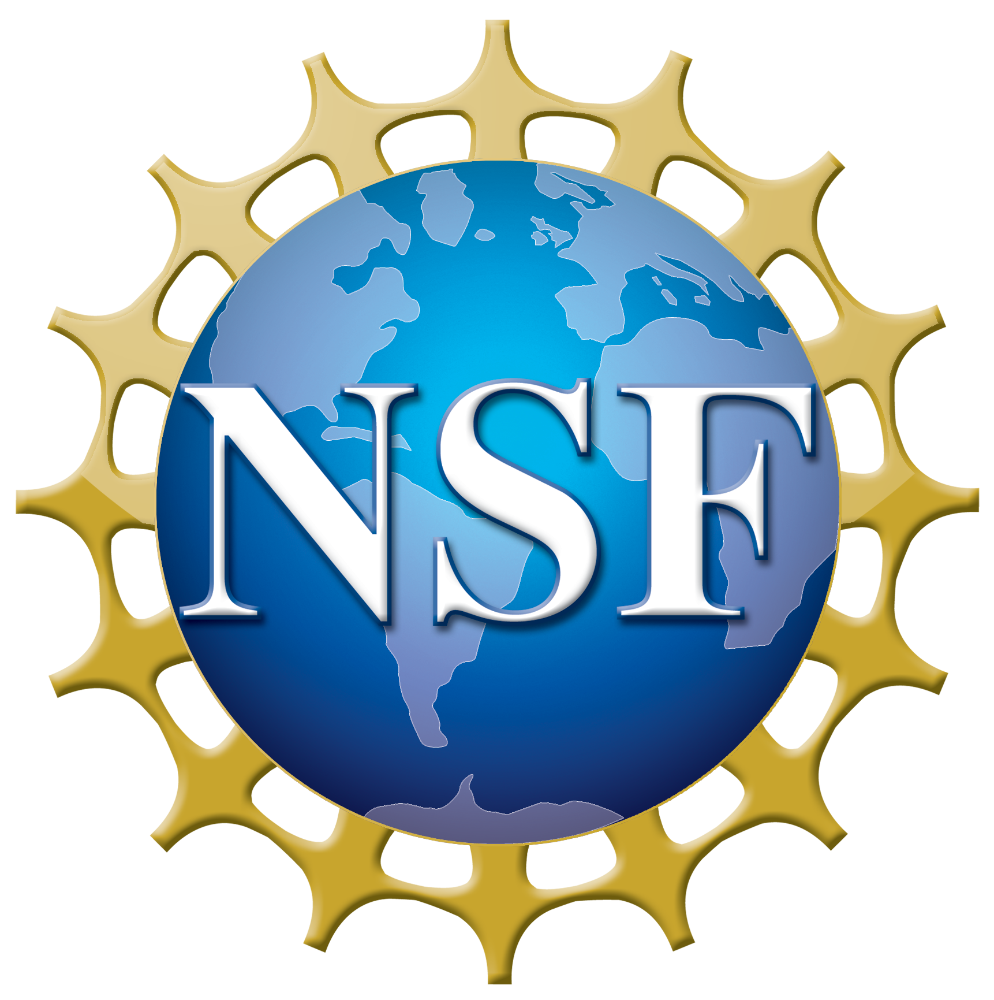
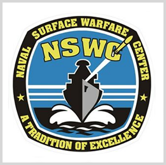
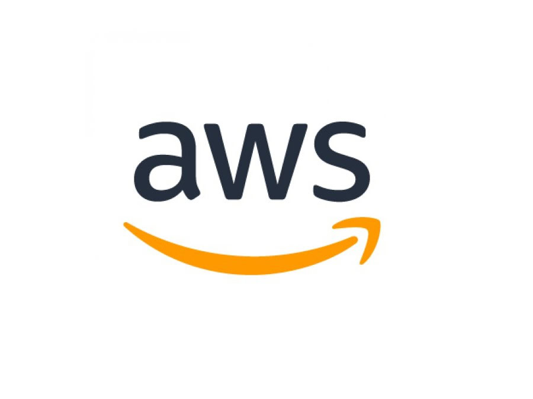
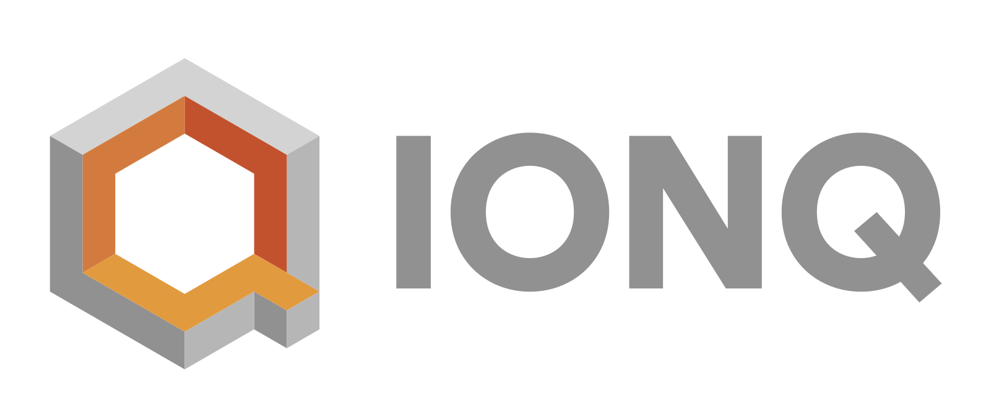
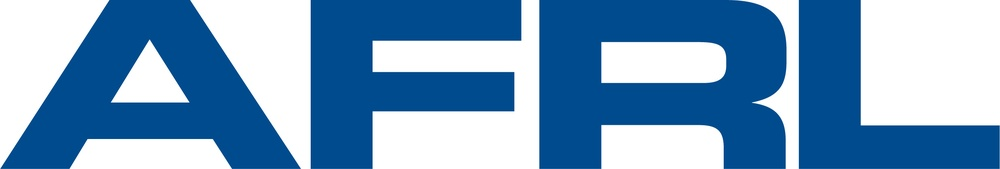

We gratefully acknowledge the support of ONR, NSF, NSWC, AWS, QuEra, IonQ, Air Force Research Laboratory, and Eaton Research Labs.

## Office of Naval Research

{width="180" fig-alt="Office of Naval Research"}

## National Science Foundation

{width="180" fig-alt="National Science Foundation"}

## Naval Surface Warfare Center

{width="180" fig-alt="Naval Surface Warfare Center"}

## Amazon Web Services

{width="180" fig-alt="Amazon Web Services"}

## QuEra

{width="180" fig-alt="QuEra"}

## IonQ

{width="180" fig-alt="IonQ"}

## Air Force Research Laboratory

[{width="180" fig-alt="Air Force Research Laboratory (AFRL)"}](https://afresearchlab.com/)

## Eaton Research Labs

[{width="180" fig-alt="Eaton Research Labs - Eaton logo"}](https://www.eaton.com/us/en-us/company/research-and-development.html)
